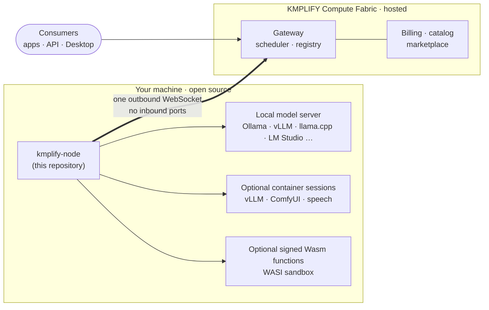
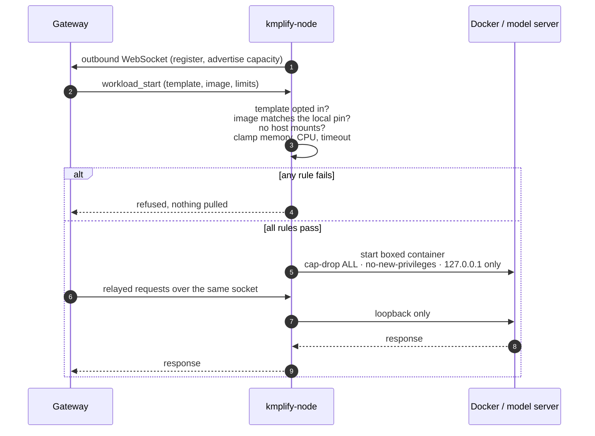

<div align="center">

<a href="https://kmplify.io/platform/kmplify-node">
  <picture>
    <source media="(prefers-color-scheme: dark)" srcset=".github/assets/kmplify-logo-dark.svg">
    
  </picture>
</a>

<h1>kmplify-node</h1>

**Lend your GPU to the KMPLIFY Compute Fabric, on your terms.**<br>
The open-source provider agent: it serves inference, container sessions and signed
Wasm functions from your machine over a single outbound connection, and enforces
every limit you set on your side of the wire.

[](https://github.com/kmplify/kmplify-node/actions/workflows/ci.yml)
[](https://github.com/kmplify/kmplify-node/releases)
[](LICENSE)

[](PROTOCOL.md)
<br>


<h3>
  <a href="#install">Install</a>
  ·
  <a href="https://kmplify.io/platform/kmplify-node">What kmplify-node is</a>
  ·
  <a href="https://kmplify.io/platform/compute-fabric">Compute Fabric</a>
  ·
  <a href="https://github.com/kmplify/kmplify-node/releases">Releases</a>
  ·
  <a href="docs/ONBOARDING.md">Onboarding walkthrough</a>
</h3>

<sub>
  <a href="#what-it-does">What it does</a> ·
  <a href="#hardware-support">Hardware</a> ·
  <a href="#run">Run</a> ·
  <a href="#the-cli">CLI</a> ·
  <a href="#the-terminal-dashboard">Dashboard</a> ·
  <a href="#configuration">Configuration</a> ·
  <a href="#trust-model">Trust model</a> ·
  <a href="#running-your-own-fabric">Your own fabric</a> ·
  <a href="#learn-more">Learn more</a>
</sub>

</div>

---

This is the half of the fabric that runs on **your** machine, and it is open
source for exactly that reason. Deciding to lend a stranger your GPU is not a
decision anyone should make about a binary they cannot read.



<table>
<tr>
<td width="33%" valign="top">

**🔒 Nothing listens**<br>
One outbound WebSocket carries everything, including the relay to hosted
sessions. No port forwarding, no firewall rule, no domain.

</td>
<td width="33%" valign="top">

**🎛️ Your limits, enforced here**<br>
CPU, VRAM, RAM and disk ceilings are clamped on this side, not requested
politely from the gateway.

</td>
<td width="33%" valign="top">

**🧾 Honest capacity**<br>
Real GPU model and VRAM, physical cores, cgroup limits. The fabric only
advertises what this machine can actually serve.

</td>
</tr>
</table>

## What it does

- **Serves inference** from a local OpenAI-compatible endpoint (Ollama, vLLM,
  LiteLLM, TGI, llama.cpp) to consumers on the fabric. Prompts and responses
  pass through your machine and the model runs on your hardware.
- **Runs on the GPU you have.** NVIDIA (CUDA), AMD (ROCm), Intel (oneAPI) and
  Apple Silicon (Metal) are detected and reported distinctly, with the right
  container flags per vendor. See the matrix below.
- **Advertises honestly**: real GPU model and VRAM, physical cores rather than
  threads, cgroup limits rather than the host's numbers when containerised.
- **Optionally hosts container sessions** (vLLM, ComfyUI, Ollama, speech
  to text and text to speech) on your GPU.
  Off by default. This is opt-in per template, and never inferred from the fact
  that you have the hardware.
- **Enforces your ceilings**: CPU, VRAM, RAM and disk caps you set are applied
  on this side, not requested politely from the other.
- **Optionally runs signed Wasm functions** in an in-process WASI sandbox
  (stdin/stdout only, no files, no network), only for a catalog key you chose
  to trust, and **optionally lends vector storage** for replicated RAG
  indexes whose payloads are opaque to you. Both off by default and both
  switchable without a restart; protocol v3.0 in [PROTOCOL.md](PROTOCOL.md).

  ```bash
  kmplify-node set functions=true functions-pubkey=$(curl -s https://fabric.kmplify.io/v1/functions | jq -r .pubkey)
  ```

  The modules the public fabric asks nodes to run are in
  [functions/](functions/) — source, build script and hashes — because a
  signature says where bytes came from, not what they do.

### Hardware support

| Platform | Accelerator | Serves inference | Hosts container sessions |
|---|---|---|---|
| Linux | NVIDIA / CUDA | yes | yes (`--gpus all`) |
| Linux | AMD / ROCm | yes | yes (`/dev/kfd` + `/dev/dri`) |
| Linux | Intel / oneAPI | yes | yes (`/dev/dri`) |
| Windows | NVIDIA / CUDA | yes | yes, native Linux containers only |
| Windows | AMD / ROCm | yes | HIP SDK dependent |
| macOS | Apple Silicon / Metal | yes | **no** |
| any | CPU only | yes (small models) | yes (CPU templates) |

Two honest caveats. **macOS cannot host sessions at all**: the Docker daemon
runs in a VM with no GPU passthrough, so a Mac lends inference through its
local model server and the node refuses session work rather than accepting it
and running on CPU at minutes per answer. And **vLLM templates need native
Linux**, not WSL2, because vLLM's V1 engine requires UVA.

Detection is automatic. `KMPLIFY_GPU_BACKEND=cuda|rocm|oneapi|metal|cpu`
overrides it, and `kmplify-node check` prints every accelerator it found plus
which one goes on the wire.

There are deliberately **two** questions being asked, and they can disagree:

- **Is a GPU usable, and how big?** The vendor tool is executed and its VRAM
  parsed. This is what the node advertises, because advertising capacity to a
  fabric promises that work can actually land on it.
- **Is a driver stack installed?** Filesystem lookups only, no subprocess.
  This is what decides whether local inference is worth attempting at all.

A machine with `nvidia-smi` present but a broken driver answers CUDA to the
second and CPU to the first, and both answers are right. `check` says so
explicitly when they differ, so "I installed ROCm and it still says cpu" has a
visible cause rather than being a mystery: the stack is there, its tool did
not answer, and the fabric only advertises what it can size and serve.

CUDA and Metal are verified on real hardware. The ROCm and oneAPI paths are
written against the documented output of `rocm-smi`, `amd-smi` and `xpu-smi`
and unit-tested on captured samples, but have not yet run on an AMD or Intel
GPU. If you have one, `kmplify-node check` output is the most useful bug
report you can file.

## What it does not do

It never listens on a port. It opens one outbound WebSocket and everything,
including the HTTP relay to a hosted session, travels back over it. Joining a
fabric does not expose your machine to the internet, and you do not need to
forward a port, open a firewall or own a domain.

It has no account. A node registers anonymously and gets an opaque id and
token; there is no email, no PII, and nothing tying the machine to a person
unless you separately link it for payouts.

It holds no balance. Where the fabric has KMPLIFY Credits switched on, a node
that hosts rented GPU sessions earns credits for the account it is linked to,
and shows what the gateway reports about them. Credits are a prepaid balance
for KMPLIFY services, not a currency, and there is no cash payout. See
[docs/CREDITS.md](docs/CREDITS.md).

It holds no wallet. No key material, no address, no chain client, no token —
being paid is an optional companion program that reads what this node
publishes and settles against the fabric's own signed receipts. See
[docs/REWARDS.md](docs/REWARDS.md) for the boundary and
[`kmplify-node rewards`](#rewards--what-it-delivered-and-optionally-what-that-earns)
for what an operator sees.

## Install

One line, on Linux (x86_64/aarch64) and macOS. It downloads the release
binary for this machine, verifies it against the release's SHA256SUMS, and
ends with the `check` preflight:

```bash
curl -fsSL https://raw.githubusercontent.com/kmplify/kmplify-node/main/scripts/install.sh | sh
```

For a 24/7 server or VPS, let it also set up the systemd service (creates
the `kmplify` user, installs the unit and `/etc/kmplify-node.env`):

```bash
curl -fsSL https://raw.githubusercontent.com/kmplify/kmplify-node/main/scripts/install.sh | sudo sh -s -- --service
```

As a container (inference-only; container sessions need the binary on the
host, where it can drive Docker and see the GPU):

```bash
docker run -d --name kmplify-node --network host -v kmplify-node-data:/data ghcr.io/kmplify/kmplify-node
```

Or from source:

```bash
cargo install --git https://github.com/kmplify/kmplify-node
```

Prebuilt binaries, their SHA256SUMS, the systemd unit and the env template
are attached to every [GitHub release](https://github.com/kmplify/kmplify-node/releases).

## Run

First time? One command walks the whole setup with you:

```bash
kmplify-node init
```

It looks at the machine, scans localhost for the inference engine you already
run (Ollama, llama.cpp, vLLM, LM Studio, LiteLLM, Jan, colibri), asks the
sharing questions in plain words, fetches the fabric's function key if you
opt into that lane, saves everything, preflights it and offers to start.
Nothing is shared until you confirm the summary, and Ctrl-C abandons all of
it. The answers land in the same `settings.json` that `kmplify-node set` and
the dashboard write, so nothing about the wizard is special — it is just the
guided way in. The full annotated walkthrough, captured from a real run, is
in [docs/ONBOARDING.md](docs/ONBOARDING.md).

Already configured? The short loop is:

```bash
kmplify-node check
```

```bash
kmplify-node
```

Then watch and steer it from a terminal:

```bash
kmplify-node tui
```

### When the node ends without a word

Every start writes `startup.log` to the node directory (the first line the
node prints names it): one timestamped line per start step, the previous
start kept as `startup.prev.log`. Whatever ended the process, the last line
is the step it was in. A crash also writes `startup-crash.log` there, with
the message and a backtrace (in the temp directory when the node directory
cannot be written). Neither file holds a token or an environment value.

On Windows, also look at:

- `$LASTEXITCODE` right after the node returned to the prompt. `-1073741571`
  (`0xC00000FD`) is a stack overflow, `-1073741819` (`0xC0000005`) an access
  violation, `1` or `2` a refused start (the reason is printed) and `101` a
  crash with a report.
- Windows Security > Virus & threat protection > Protection history: Defender
  stopping or quarantining `kmplify-node.exe` leaves no message in the
  console.

A Docker that is not running, or does not answer, is not a reason to stop:
the node says so in one line, leaves containerised sessions off and keeps
lending chat models. A GPU tool or Docker that never answers is given up on
after 15 s and 5 s.

### Your engine, found rather than typed

KMPLIFY ships no model runner of its own; the node lends whatever
OpenAI-compatible engine you already run. `engines` shows what is listening
and which one the node uses:

```bash
kmplify-node engines
```

```
  Ollama       http://127.0.0.1:11434   17 (qwen3:0.6b, bge-m3:567m, …) <- active
  LM Studio    http://127.0.0.1:1234    28 (qwen/qwen3.8-27b, …)

suggestion: mlx fits this machine (Apple Silicon), it is not running yet — kmplify-node set engine=mlx
```

The suggestion is the hardware speaking — MLX on Apple Silicon, llama.cpp
with CUDA/ROCm offloading where a card is usable — and `init` highlights the
same row in its engine menu. It never applies itself: switching stays your
one deliberate command.

Switching is one durable setting, by name or by URL, applied on the
reconnect it triggers:

```bash
kmplify-node set engine=lmstudio
```

```bash
kmplify-node set engine=http://10.0.0.7:8000
```

(The underlying variable keeps its historic name, `OLLAMA_BASE`; the engine
behind it is anything that speaks the OpenAI API.)

Everything below is the detail behind those commands.

## Using kmplify-node: dashboard and terminal

`kmplify-node` (or `kmplify-node run`) has three views of a running node, and
you can switch between them while it runs, without a restart:

| View | What you get | Start with |
|---|---|---|
| Terminal view | The terminal dashboard in the console the node runs in (the same screens as `kmplify-node tui`) | `--ui tui`, or `1` in the chooser |
| Web view | The dashboard in your browser | `--ui gui`, or `2` in the chooser |
| App window | The node's native window: the same sections, figures and buttons, plus the LAN router | `--ui app` (or `--ui native`), `3` in the chooser, or `kmplify-node window` for a node already running |

**The chooser.** Started by hand in a console (a terminal, or a double-click on
`kmplify-node.exe`), with no `--ui` and nothing remembered, the node asks which
view to start with. Type `1`, `2` or `3` and Enter; add `r` (for example `2r`) to
remember the choice in the node's settings file (`kmplify-node set --clear ui`
asks again; the file holds no credentials). Without an answer within 15 seconds
it starts the default: the web view in a desktop session, the terminal summary
elsewhere. A service, a systemd unit, a container without a TTY, a redirected or
piped start is never asked and behaves as before.

**Switching.** `--ui` is only the starting view. In an interactive start the
local dashboard runs in every view, so:

- in the console, type `t` (terminal view), `w` (web view) or `a` (app window),
  then Enter;
- in the terminal view, `b` opens the web view and `a` the app window; `q`
  returns to the console and the node keeps running;
- on the dashboard, the **View** buttons at the top (Web, App window, Terminal)
  do the same; Terminal brings the terminal view up in the console window the
  node runs in.

The app window is a native window (egui, the `native-gui` feature, on by
default) in a process of its own that attaches to the node: closing it leaves
the node running, stopping the node closes it. Where it cannot open (no
display, or a build without it such as the static Linux release binaries), the
node falls back to the dashboard in a Chromium-family browser in app mode (no
tabs, no address bar): Edge on Windows, Chrome, Edge, Chromium or Brave on
macOS and Linux, else your normal browser with a note. The link goes to the
browser as a program argument, never through a shell, so the per-start token
is visible in your own process list, exactly as it is when the node opens your
browser. The window and the LAN router it shows are described in
[docs/ROUTER.md](docs/ROUTER.md).

The other starts keep their meaning: `--ui terminal` is the startup summary in
the console (plus the view keys when you are at it), `--ui none` plain log lines
for services and log collectors. `KMPLIFY_NODE_UI` sets the same as `--ui`,
`--ui-port PORT` (`KMPLIFY_NODE_UI_PORT`) picks the dashboard's port (default: a
free one), and `--no-ui-open` keeps the browser closed while still serving the
page.

**One feature set in every view.** The terminal view, the web dashboard and the
app window show the same sections, metrics and actions, from one data layer
(`views::model` over the node's status snapshot) and one set of handlers (the
node's control commands and settings file). A parity test on each side fails
when a view drops one. This table is also the contract for the native window and
for the provider view of the KMPLIFY desktop app:

| Section | Web tab | Terminal key | Shows |
|---|---|---|---|
| Overview | Overview | `1` `h` | Trusted node with trust readiness, what this node shares, connection, this machine (CPU, RAM, GPU) |
| Trusted node | Trusted node | `8` `n` | where this node stands, trust readiness, what is missing, what Trusted means, the security baseline with fixes |
| Sessions | Sessions | `2` `s` | running now, since this start |
| Earnings | Earnings | `9` `$` | this month, in total, account and rate |
| Settings | Settings | `0` (editor `5` `g`) | every setting, its value, where it comes from, how to change it; the starting view |
| Logs | Logs | `4` `l` | the last log lines, keys and tokens redacted |

| Action | Web | Terminal key |
|---|---|---|
| Pause sharing / Resume sharing | Overview, Connection | `p` |
| Reconnect now | Overview, Connection | `c` |
| Re-check now (security baseline) | Trusted node | `R` |
| Change a setting / Use environment | Settings | `5`, then `d` hands one back |
| Stop session | Sessions | `e` |
| Save a report (a text file in the node directory) | Overview, Connection | `w` |
| Stop the node | Overview, Connection | `x` |
| Switch view: Web / App window / Terminal | View buttons | `b` / `a` / (this view) |

Where the web page draws a chart, the terminal says it in text: the readiness
ring is the bar `[##--##] 4/6 checks`, the machine bars are block bars with a
one-minute sparkline. The terminal view has three screens beyond the table that
the web page does not have yet: Models (`3`), Peers (`6`: approve, deny, block,
invite, hold and revoke consumers) and Activity (`7`: five minutes of history and
a bar per core).

**The startup summary.** Once the node is connected (or has tried for 30 seconds)
it prints one block: the fabric it is connected to, the machine, what it shares
(chat models, serverless apps, CPU and RAM, functions, vectors), its trust level
as the fabric reports it, and the top items missing for a Trusted node with a
one-line fix each. A node without language models says so as information: "No
language models shared for chat; serverless apps are still offered." When the
security check finishes later (Windows' update search can take two minutes), the
trust part follows. `kmplify-node status` prints the same, plus every baseline
item, at any time.

**The dashboard.** Pages: Overview (connection, node, version, uptime, what is
shared and what "no models" means), Trusted node (every baseline item with its
state, the exact reason, how the fabric evaluated it, step-by-step fixes for this
system and the others, and **Re-check now**), Sessions (what runs here, never
what a consumer sends), Earnings (KMPLIFY Credits where the fabric reports them),
Settings (the sharing settings `kmplify-node set` changes, editable; everything
else with how to change it) and Logs (the newest lines, keys and tokens
redacted). The fabric's view comes from the gateway's public `/fabric/nodes` list,
where a node is named by a prefix of its id (24 hex characters today; 8 and 16 on
older gateways, all accepted). The page says which of two things went wrong when
the level is not known: the fabric could not be reached (with the error), or it
answered but does not list this node yet (it is read again within 30 seconds).

**Trust readiness.** The Overview and the Trusted node page show a ring with how
many of the six baseline items pass (green: all six, amber: four or five, red:
three or fewer), the items one by one, and the three conditions for Trusted as
separate steps: the security baseline of this machine, the identity check of the
provider account, and the trust grant by KMPLIFY. The node cannot see the account
side, so those two steps read "not confirmed" until the fabric lists the node as
Trusted. While the self-check runs, the ring and the items show how far it got
("Checking: 2 of 6 checks read..."). Every state is written out, never colour
only, and the terminal summary, `kmplify-node status` and `kmplify-node tui` show
the same verdict:

```
  Readiness   [-##-##] 4/6  Ready for Trusted: 4 of 6 checks passed; missing: disk encryption, screen lock.
    Step 1  [todo] Security baseline (this machine): 4 of 6 passed
    Step 2  [open] Identity check (provider account): your KMPLIFY provider account passes the identity check ...
    Step 3  [open] Trust grant (KMPLIFY): KMPLIFY grants Trusted for this node once the account check passes
```

In the bar `#` is a passing item, `-` a failing or unreadable one, `.` one still
being checked.

It is the one place the node listens, so it is locked down: it binds to
127.0.0.1 only and refuses any other address; every request needs the random
token in the link the node prints (32 bytes, new on every start); requests naming
another host or coming from another site are refused and no CORS headers are
sent; changes need the token in a header and a JSON body; page, script and style
are compiled into the binary under a strict content security policy (the Inter
font and the KMPLIFY logo too; nothing loads from another site). The link is
kept, owner-readable only, in `dashboard.url` in the node directory while the
node runs, so `kmplify-node status` can show it again.

**Windows: administrator rights.** Windows shows the BitLocker state of some
drives only to administrators. A node started without them reports disk
encryption as unknown (which counts as failing) and says exactly that; it never
elevates itself. To see the result once, open PowerShell with "Run as
administrator" and run `kmplify-node security check`. To have the node send it,
start it from an elevated PowerShell, or at startup as a scheduled task with
highest privileges:

```powershell
schtasks /Create /TN kmplify-node /SC ONSTART /RU SYSTEM /RL HIGHEST /TR "\"C:\Program Files\kmplify-node\kmplify-node.exe\" run --ui none --node-dir C:\ProgramData\kmplify-node"
```

A task running as SYSTEM uses the node directory you give it, so point
`--node-dir` at the directory you want the node identity in. It cannot read your
own screen lock setting; `kmplify-node security check` run as you shows it.

### On a Linux server without a desktop

Nothing needs a display. Over SSH, in a container or under systemd the node
picks `--ui terminal` by itself (no browser, no dashboard port); say it
explicitly with `kmplify-node run --ui terminal`, or `--ui none` for plain log
lines only.

```bash
kmplify-node run --ui terminal     # in the foreground: the startup summary, then log lines
kmplify-node status                # any time, from another shell: link, sharing, trust readiness, checklist
kmplify-node status --json         # the same as data, for scripts and monitors
kmplify-node tui                   # the terminal dashboard (included in the release binaries)
kmplify-node security check        # every baseline item with how to fix it
```

Installed as a service (`install.sh --service`), the node runs as the user
`kmplify` with its directory in `/var/lib/kmplify-node`; read it as that user:

```bash
sudo -u kmplify KMPLIFY_NODE_DIR=/var/lib/kmplify-node kmplify-node status
sudo -u kmplify KMPLIFY_NODE_DIR=/var/lib/kmplify-node kmplify-node tui
systemctl status kmplify-node      # running, since when, last lines
journalctl -u kmplify-node -f      # follow the log
journalctl -u kmplify-node -b      # everything since the last boot
```

The startup summary, including the trust readiness, is in the journal too.

## The CLI

One binary, seven commands. Everything an operator does to a node — preflight
it, run it, watch it, change what it lends, decide who may use it — is here,
so a machine with no desktop is no harder to run than one with a window.

| Command | What it does |
|---|---|
| `kmplify-node init` | First-run wizard: find your engine, answer six questions, preflight, start. |
| `kmplify-node` / `run` | Join the fabric and serve. Logs to stdout, stops cleanly on SIGTERM. |
| `kmplify-node engines` | Scan localhost for inference engines; say which one is active. `--json`. |
| `kmplify-node tui` | Terminal dashboard: watch **and control** the node. |
| `kmplify-node check` | Preflight this host. Connects to nothing. `--json`, `--timeout SECS`. |
| `kmplify-node status` | Is it serving right now, what it shares, its trust level and the baseline checklist. `--json`. |
| `kmplify-node set` | Change what this machine lends, durably and without a restart. |
| `kmplify-node peers` | Who may use it — list, approve, deny, block, invite, revoke. `--json`. |
| `kmplify-node rewards` | What this node delivered, and what an optional payout companion says. |
| `kmplify-node id` | Print this install's node id, the handle consumers pin and invite. |
| `kmplify-node link-code` | Print a link code (valid 10 minutes, once) to link this machine to your KMPLIFY account in the marketplace: Settings > Peer Compute > Link code. Signed by the node's identity key; carries no personal data. Without `--nonce` the code is not bound to an account: whoever has it within 10 minutes can redeem it. Binding is recommended: KMPLIFY Desktop makes bound codes for the signed-in account, or pass `--nonce X` with the challenge your account shows (marketplace: Settings > Peer Compute). `--json` for scripts. |
| `kmplify-node version` · `help` | Version and build stamp; the full flag list. |

**One configuration surface.** Settings are environment variables, so a
service manager, a container and a shell all configure it the same way — and
every one also has a flag that *sets that variable* rather than living beside
it. `--gateway https://…` is `PROVIDER_GATEWAY_URL=https://…`, no more and no
less, which is what lets `check` report exactly what `run` would use.

**Exit codes**, so a provisioning script can branch: `0` ready or a clean
stop, `1` this host cannot serve as configured (or nothing is running), `2`
the command line or the configuration is wrong. A value that cannot be read —
a ceiling that is not a number, a country that is not alpha-2 — stops the node
at startup naming the variable, rather than falling back to a default nobody
chose.

### `check` — will this host actually serve?

Run it first. It connects to nothing: it resolves the configuration, probes
Docker, the vendor GPU tools, the gateway and your model endpoint, and tells
you what the fabric would see.

```bash
kmplify-node check
```

```
kmplify-node 0.3.0+c8ba618

configuration
  gateway    : https://fabric.kmplify.io
  creds      : ~/.config/kmplify-node/fabric_node.json
  ollama     : http://127.0.0.1:11434
  inference  : ON
  sessions   : OFF (set PROVIDER_WORKLOADS to opt in)
  ceilings   : cpus=None vram_mb=None ram_mb=None disk_gb=None

accelerator
  metal      : Apple M2 Max (49152 MB) <- advertised
  advertised : metal

probes
  gateway    : reachable (http 405)
  docker     : 29.6.2
  models     : 17 (qwen3:0.6b, bge-m3:567m, gemma4:12b-mlx, …)

WARNING: PROVIDER_COUNTRY is undeclared, so the gateway records XX and
         consumers filtering for EU residency will not see this node

ready.
```

A node that lists no models will connect, count as online, and have every job
refused by the scheduler — so `check` fails loudly on that rather than letting
you deploy something that looks healthy and serves nothing. Probes run
concurrently with a per-probe timeout, so a wedged Docker socket cannot hang
it. `--json` gives the same verdict, warnings and errors in a form a script
can read.

Flags are handy for trying a setting before writing it into a unit file:

```bash
kmplify-node check --workloads vllm-openai --max-vram-mb 16000
```

### `run` — join the fabric and serve

```bash
kmplify-node
```

Logs to stdout (journald adds the timestamps). On SIGTERM — what `systemctl
stop` sends — the worker tears down every hosted session container before
exiting, so a stopped node leaves nothing of other people's running on your
GPU. If the worker ever dies unexpectedly the process exits non-zero, so a
service manager restarts it instead of leaving a healthy-looking process that
lends nothing.

For a 24/7 box see [docs/HEADLESS-NODE.md](docs/HEADLESS-NODE.md) and the
systemd unit in [packaging/](packaging/).

### `status` — what is it doing right now?

```bash
kmplify-node status
```

```
ONLINE pid 30736 up 3h 12m
  node     : 8f2c1a5b90de4a17b3c9d0e5f6a7b8c9
  gateway  : https://fabric.kmplify.io
  models   : qwen3:0.6b, bge-m3:567m, gemma4:12b-mlx, …
  load     : cpu 38%  gpu 70%  ram 41/64 GB
  jobs     : 2 active, 914 finished, 3 errors, avg 812 ms
  sessions : 1
```

Exits `1` when no node is running here, so `kmplify-node status >/dev/null ||
alert` is a monitor. `--json` adds every field the dashboard draws — link
state, per-core load, VRAM, ceilings, hosted sessions, the log tail — which is
the machine-readable half of the monitoring story below.

Where the fabric has KMPLIFY Credits switched on, three more lines follow:
what this node earned this month and in total, the rate of its GPU class with
the platform fee, and whether the node is linked to a KMPLIFY account. With
the credit system off they are absent and the output is as above.

```
  credits  : 1240 earned this month · 5678 in total
  rate     : class M (24 GB) · … credits per minute · platform fee … % · about … per minute to this node
  account  : linked
```

The rate and the fee are the gateway's, read at that moment. On a node that is
not linked the last line reads `NOT LINKED`, and earnings wait until it is.

### `set` — change what you lend, without a restart

The dashboard's sharing screen for a shell:

```bash
kmplify-node set max-cpus=6 share-cpu=true workloads=vllm-openai,comfyui
```

```bash
kmplify-node set --list          # what is stored here, and what it overrides
kmplify-node set --clear max-cpus   # back to whatever the unit file says
```

| Setting | Overrides | Means |
|---|---|---|
| `share-inference` | `PROVIDER_SHARE_INFERENCE` | serve chat and embedding jobs |
| `share-cpu` | `PROVIDER_SHARE_CPU` | lend spare CPU threads and RAM |
| `workloads` | `PROVIDER_WORKLOADS` | container templates to host; empty = sessions off |
| `approval-mode` | `PROVIDER_APPROVAL_MODE` | `auto` or `manual` admission |
| `country` | `PROVIDER_COUNTRY` | ISO alpha-2, for consumers who want EU capacity |
| `colibri` · `colibri-key` | `COLIBRI_BASE` · `COLIBRI_API_KEY` | second upstream for frontier MoE models |
| `max-cpus` · `max-vram-mb` · `max-ram-mb` · `max-disk-gb` | the matching `PROVIDER_MAX_*` | ceilings peer sessions never exceed |
| `functions` · `functions-pubkey` | `PROVIDER_FUNCTIONS` · `PROVIDER_FUNCTIONS_PUBKEY` | host signed Wasm functions, and the catalog key to trust |
| `share-vectors` · `max-vector-mb` | `PROVIDER_SHARE_VECTORS` · `PROVIDER_MAX_VECTOR_MB` | hold peers' vector collections, and how much |
| `rewards` | `PROVIDER_REWARDS` | may the node ask an installed payout companion |

Writes `settings.json` in the node directory (mode 0600 — it can hold the
colibri key) and nudges the running node, which re-advertises within a second;
a node that is offline picks the change up on its next connection. **A stored
choice overrides the environment** — the same contract the desktop app has —
so a ceiling does not spring back on the next restart. Nothing about that is
silent: `check` prints every value currently overriding the environment,
`set --list` shows them, and clearing one restores the unit file's value with
no restart.

### `peers` — who may use this machine

`auto` (the default) lets any consumer on the fabric use it. `manual` parks
unknown consumers until you decide: they are told to ask, and they wait.
Invitations connect in either mode — minting one *is* the approval.

```bash
kmplify-node set approval-mode=manual
kmplify-node peers
```

```
admission : manual

waiting for a decision (1)
  anon-1a2b3c4d            waiting 2m       asked for llama3
      kmplify-node peers approve anon-1a2b3c4d

consumers seen recently (2)
  node-9abc…               active  via grid selection   last seen 3s   approved
  anon-deadbeef            idle    via pool             last seen 9m   blocked

invitations (1)
  7f9b2c9e-4a1d-4e5f-9c3a-2b8d1e6f0a47  Anna's phone         in use
```

| Verb | What it does |
|---|---|
| `peers approve <consumer>` | admit them — a standing rule, so it holds |
| `peers deny <consumer>` | refuse quietly while manual admission is on |
| `peers block <consumer>` | refuse in **every** mode |
| `peers clear <consumer>` | drop the rule; the admission mode decides again |
| `peers invite [label]` | mint an invitation; the id goes to stdout |
| `peers revoke <id>` | end an invitation for good |

It talks to the gateway with the node's stored credential rather than through
the running worker, so approving from cron works whether or not the node is
up. The listing reports the mode the **gateway** believes, falling back to the
configured one only while the node is offline — the two differ exactly while a
change has not been re-advertised, and the gateway's answer is the one that
decides who gets in.

Invitations are meant to be scripted:

```bash
INVITE=$(kmplify-node peers invite "Anna's phone")
```

### Earning KMPLIFY Credits

A node that hosts **rented GPU sessions** (GPU apps and container sessions)
earns KMPLIFY Credits for the seconds the renter paid for.

- **What they are.** A prepaid balance for KMPLIFY services. Credits are not a
  currency, cannot be traded or transferred, and there is **no cash payout**:
  earned credits are spent on KMPLIFY services, for example on renting a
  bigger GPU than your own. They are valid for 24 months.
- **The rate.** A session is priced per minute by the GPU class of the host
  (S, M, L or XL, by the VRAM the node lends) and metered per second.
- **The fee.** KMPLIFY keeps a platform fee, a percentage of what the renter
  is charged. The rest is credited to you.
- **Where the numbers are.** Rate and fee are set on the server and can
  change, so none is written here. `kmplify-node status` and `kmplify-node
  rewards` show the current ones.
- **Linking.** Earnings are booked to the KMPLIFY account the node is linked
  to. Until it is linked they wait, and they are moved when you link it: run
  `kmplify-node id`, copy the `kmpn1…` address, and in the KMPLIFY app choose
  Settings, "Your KMPLIFY identity", "My nodes", "Claim node".
- **What does not earn.** Chat and embedding jobs, functions and vector
  collections cost their users no credits and earn none.

`kmplify-node rewards` shows the figures, the latest earnings and, on an
unlinked node, the linking steps with the address already printed. The whole
feature is switched on at the gateway; with it off, the node shows nothing
about credits. Details: [docs/CREDITS.md](docs/CREDITS.md).

### `rewards` — what it delivered, and (optionally) what that earns

The node lends hardware. It holds no wallet, signs no transaction and knows no
token — being paid is a **separate program** an operator installs on purpose.
This command shows the node's own half either way:

```bash
kmplify-node rewards
```

```
this node
  node id  : 44802ebc90e24de18825b90af320edfe
  gateway  : https://fabric.kmplify.io

delivered since this node started (6h 12m)
  jobs     : 914 answered in 742.1 s of compute
  sessions : 3 hosted, 14h 24m of machine time
  (the node's own count — the fabric's signed receipts are what settle)

rewards companion
  off. Rewards are optional and this node needs nothing to serve.
```

Install a companion and switch it on, and the same command — and the
dashboard's home screen — shows what it reports:

```bash
kmplify-node set rewards=on
```

```
rewards companion
  /usr/local/bin/chaingence-plugin
  TESTNET  12.40 tEURC pending  ·  0.00 tEURC paid  ·  evm:base-sepolia
```

Two deliberate acts are required, because running another program is not
something a node should do because a binary happened to be on `PATH`. The
node publishes `identity.json` — its public node id, never its credential —
and the delivered-work counters above; a companion reads those and settles
against the fabric's signed receipts. Nothing about serving depends on it, and
a companion that is missing, slow or unhappy costs one line of output and
nothing else.

The full contract, including what the node will never do, is in
[docs/REWARDS.md](docs/REWARDS.md). Payout rails are testnet-only today: a
balance that cannot be spent is labelled `TESTNET` everywhere it appears.

## The terminal dashboard

A node usually runs where there is no desktop, which used to mean it was
operated by reading logs. `kmplify-node tui` is the desktop app's provider
screens in a terminal, on Linux, macOS and Windows alike:

```bash
kmplify-node tui
```

It **attaches** to the node already running here (systemd, Docker, launchd),
reading the snapshot that node publishes and sending commands back to it, so
quitting the dashboard leaves the node running. If nothing is running, it
starts a node itself and quitting stops it. `--attach` insists on the first,
`--standalone` on the second.

| Screen | What it shows |
|---|---|
| `1` overview | link state, four live meters, what this node shares, the trusted node and its readiness, the connection, models, sessions, log |
| `8` trusted node | where this node stands, trust readiness, what is missing, the security baseline with fixes (the web page's Trusted node tab) |
| `2` sessions | peers' containers running here, and what this start delivered |
| `9` earnings | KMPLIFY Credits this month and in total, account and rate |
| `0` settings | every setting with its value, its source and how to change it |
| `3` models · `4` log | what consumers can ask for; the worker's log |
| `5` sharing | what this machine lends, and how much of it |
| `6` peers | who may use it: waiting consumers, active ones, invitations |
| `7` activity | CPU, GPU, VRAM and RAM live, with history and a bar per core |

| Key | Action |
|---|---|
| `p` | Pause or resume sharing. The connection and hosted sessions stay up; the node advertises nothing until resumed. |
| `c` | Reconnect to the gateway now, without waiting out the backoff. |
| `e` | Evict the selected session — the peer's container is stopped and removed. |
| `R` | Re-check now: run the security baseline check, the result goes to the fabric with the next heartbeat. |
| `x` | Stop the node, tearing down hosted sessions first. |
| `w` | Write a plain-text snapshot of the dashboard, for a bug report (the web page's "Save a report"). |
| `b` / `a` | Open the web view / the app window of the node serving in this console. |
| `?` | Every key, including the ones each screen adds. |

The node publishes `status.json` in its node directory (owner-readable only)
and accepts commands as files in `control/` there. That is how a dashboard in
one process drives a node in another **without the node listening on a
network port** — the property this whole crate is built around (the browser
dashboard is the one, opt-in exception, on 127.0.0.1 only). It also means the
dashboard must run as the user that owns that directory; for the systemd
install that is `kmplify`:

```bash
sudo -u kmplify KMPLIFY_NODE_DIR=/var/lib/kmplify-node kmplify-node tui
```

### Monitoring: the activity screen (`7`)

The question a provider actually has is "how much of my machine is gone right
now", and no log line answers it. `top` in another window cannot tell peer
work apart from your own.

```
╭ CPU ───────────────────────────────────╮╭ GPU · cuda ────────────────────────────╮
│ ████████████········  61%  4 of 16 lent ││ ██████████████······  70%  busy        │
│      ▂▃▅▆█▇▅▃▂▁▂▃▅▆█▇▅                  ││    ▁▃▅▆████▇▅▃▁▂▄▆██▇                  │
│ 13th Gen i9-13900K   5 min: avg 38% …   ││ RTX 4090 · 24576 MB  5 min: avg 52% …  │
╰────────────────────────────────────────╯╰────────────────────────────────────────╯
╭ System RAM ────────────────────────────╮╭ VRAM ──────────────────────────────────╮
│ ████████████████████  64%  41 / 64 GB   ││ ███████·············  36%  8 / 24 GB   │
╰────────────────────────────────────────╯╰────────────────────────────────────────╯
╭ cores ──────────────────────────────────────────────────────────────────────────╮
│  0 ███████···  71%    4 ██········  22%    8 █████·····  54%   12 ██········  19%│
│  1 ██████····  64%    5 █·········  11%    9 ███·······  31%   13 █·········  8% │
╰─────────────────────────────────────────────────────────────────────────────────╯
╭ what the fabric is holding ─────────────────────────────────────────────────────╮
│ sessions 1   cores held 4.0   jobs 2   finished 914   fabric disk 38.2 GB       │
╰─────────────────────────────────────────────────────────────────────────────────╯
```

Four measurements, each with a bar, the reading and **five minutes of
history**; a bar per logical CPU, which is what tells a pinned thread apart
from a busy machine; and a line for what peers are holding right now. The home
screen carries the same four meters in miniature with an inline history strip.

Colour carries meaning rather than decoration: each measurement keeps one
colour everywhere it appears (CPU cyan, GPU magenta, VRAM green, RAM blue),
each screen has its own, and a meter tints amber then red as the next request
stops fitting.

GPU load and VRAM come from `nvidia-smi` / `rocm-smi` in a single probe every
few seconds — a node lending its cycles should not spend them on being
watched. **Where a platform will not report a figure, the panel says so**
rather than drawing a zero: macOS exposes GPU load only to privileged tools,
and unified memory has no distinct "VRAM used", so a flat line along the
bottom of a graph would read as an idle card every time.

Everything on this screen is in `status.json` too, so `kmplify-node status
--json` feeds the same numbers to a monitoring system, and an attached
dashboard graphs exactly what the node measured.

### Sharing (`5`)

The desktop app's "Provide this machine's Resources" panel: switches for
inference, container sessions **per template** (built from what this
accelerator can actually host, so a Mac is offered none), CPU/RAM and manual
approval; ceilings for cores, VRAM, RAM and disk; country and colibri
upstream.

```
 what this machine lends
  [x] GPU inference (chat & embeddings)      7 model(s) advertised
  [x] CPU & system RAM                     ● 16 cores, 64 GB
  [ ] Require my approval for new peers      consumers wait until approved

 ceilings — peer sessions never exceed these
  CPU threads             ██████████████░░░░░░  9 / 16 threads ●
  VRAM                    ████████████████████  all of it (24 GB)
```

`space` toggles · `←/→` moves a ceiling (shift for a bigger step) · `enter`
edits a field · `d` hands a row back to the environment · `s` applies. Edits
are a **draft** until applied, because a ceiling is re-advertised by
reconnecting and reconnecting on every arrow key would make the node flap. A
`●` marks a value that is overriding the environment.

### Peers (`6`)

The same admission work as `kmplify-node peers`, live: `a` approve, `n` deny,
`b` block, `u` clear the rule, `i` mint an invitation, `h` hold or resume one,
`v` revoke it. It exists because the sharing screen can turn manual approval
on, and a node in manual mode with no way to approve anybody has quietly
stopped serving.

## Configuration

Environment variables, so a service manager, a container and a shell all
configure it the same way; every one also has a flag that sets it, and the
sharing ones can be changed at runtime from the dashboard or `kmplify-node
set` — which then wins over the environment until cleared. A value
that cannot be read — a ceiling that is not a number, a country that is not
alpha-2, an admission mode that is neither `auto` nor `manual` — stops the
node at startup with a message naming the variable, rather than silently
falling back to a default the operator did not choose.

| Variable | Default | Meaning |
|---|---|---|
| `PROVIDER_GATEWAY_URL` | the public fabric | Gateway to join. Point it at your own. |
| `OLLAMA_BASE` | `http://127.0.0.1:11434` | Any OpenAI-compatible endpoint, despite the name. |
| `PROVIDER_WORKLOADS` | *empty* | Container template ids to host (`vllm-openai`, `vllm-openai-lmcache`, `comfyui`, `comfyui-api`, `ollama`, `ollama-cpu`, `speaches`, `speaches-cpu`, `floci`, and on managed nodes `n8n`, `jupyter`). Empty means sessions are off. |
| `PROVIDER_COUNTRY` | *empty* | ISO alpha-2, so consumers can prefer EU capacity. Self-declared, see below. |
| `PROVIDER_SHARE_INFERENCE` | `true` | Serve model jobs at all. |
| `PROVIDER_SHARE_CPU` | `false` | Offer CPU and RAM as lendable capacity. |
| `PROVIDER_MAX_CPUS` | *unset* | Ceiling on cores lent to sessions. |
| `PROVIDER_MAX_VRAM_MB` | *unset* | Ceiling on advertised VRAM. |
| `PROVIDER_MAX_RAM_MB` | *unset* | Ceiling on advertised RAM. |
| `PROVIDER_MAX_DISK_GB` | *unset* | Ceiling on disk sessions may fill. |
| `PROVIDER_APPROVAL_MODE` | `auto` | `manual` holds each session for your approval. |
| `COLIBRI_BASE` | *empty* | Optional second upstream for MoE streaming. |
| `KMPLIFY_NODE_DIR` | `$XDG_CONFIG_HOME/kmplify-node` | Where the node identity is stored. |
| `KMPLIFY_GPU_BACKEND` | autodetect | Force the accelerator: `cuda`, `rocm`, `oneapi`, `metal`, `cpu`. |
| `KMPLIFY_CUDA` | autodetect | Older CUDA-only override (`1`/`0`). Still honoured. |
| `KMPLIFY_FABRIC_EXTRA_IMAGE_PINS` | *empty* | Extra `template=repository` image pins. See below. |
| `PROVIDER_FUNCTIONS` | `false` | Host signed Wasm functions. The runtime ships in the released binaries; this switch and a catalog key are what turn it on. |
| `PROVIDER_FUNCTIONS_PUBKEY` | *empty* | Hex Ed25519 key of the function catalog to trust. Empty = refuse all. |
| `PROVIDER_MAX_FUNCTION_MB` | `256` | Per-call memory ceiling (hard cap 1024). |
| `PROVIDER_MAX_FUNCTION_MS` | `30000` | Per-call wall-clock ceiling (hard cap 300000). |
| `PROVIDER_REWARDS` | `false` | May the node ask an installed payout companion for a status line. See [docs/REWARDS.md](docs/REWARDS.md). |
| `PROVIDER_SHARE_VECTORS` | `false` | Lend storage for replicated vector collections. |
| `PROVIDER_MAX_VECTOR_MB` | `1024` | Ceiling on stored collections. |

`PROVIDER_COUNTRY` is self-declared and the gateway cannot verify it. It exists
so consumers can *prefer* EU/EEA capacity, which is a data-residency preference
and not an attestation. Declaring a country you are not in defeats the point
for the consumer, not for you.

## Trusted node baseline

Personal or confidential work only runs on Trusted nodes. Trusted needs two things:
the provider's KMPLIFY account passed the identity check, and the machine meets a
security baseline that the node checks itself. See what yours says:

```sh
kmplify-node security check          # the checklist, with how to fix each item
kmplify-node security check --json   # the same as data; exit code 0 when it passes
```

| Item | Passes when | Windows | macOS | Linux |
|---|---|---|---|---|
| Disk encryption | the system and data volumes are encrypted | BitLocker on every fixed drive | FileVault on | every mounted filesystem but /boot and EFI on LUKS (dm-crypt), swap included |
| Security updates | none is waiting, or the last one is at most 30 days old | Windows Update history and search, "Security Updates" classification, and hotfixes | install history (macOS updates and security responses; XProtect does not count) and `softwareupdate -l` | apt history, unattended-upgrades stamp and `apt-get -s dist-upgrade` (security pocket); dnf history and `dnf updateinfo --security`; pacman log (waiting updates unknown) |
| Firewall | it is on | Defender Firewall on for domain, private and public | Application Firewall on | ufw or firewalld on, or an nftables input chain that drops |
| Screen lock | desktops lock within 15 minutes | lock policy or a password screen saver | password on screen saver or display sleep | GNOME or KDE lock settings; not checked without a desktop session |
| SSH password logins | off, or no SSH server | sshd_config of OpenSSH Server | sshd_config when Remote Login is on | `sshd -T` when allowed, sshd_config otherwise |
| SSH root login | `PermitRootLogin` is not `yes` | does not apply | sshd_config | as above |

How the node checks:

- At start and every 3 hours. The result goes to the fabric in the hello and every
  pong, signed with the node's identity key (PROTOCOL.md, v5.5). The fabric decides
  the trust level, and a check older than 6 hours no longer counts.
- What it cannot read is reported as unknown, never guessed, and unknown counts as
  failing. Screen lock and SSH are the exception: without a desktop session or an
  SSH server there is nothing to check.
- It never asks for more rights than it has: no `sudo`, no elevation prompt. When a
  check needs administrator rights (BitLocker on some Windows drives, the nftables
  rules on Linux), the value is unknown and the checklist says so.
- Only the facts above are sent: no drive names, mount points, file paths or user
  names. The checklist shows those details on your screen only.
- The separate network segment for a Trusted node is your declaration when you accept
  the provider terms; it is not checked here.

## Trust model



The gateway schedules. The node decides what its own hardware does. Every rule
below is enforced here, in code you can read, and none of them depend on the
gateway behaving:

- **Sessions are opt-in per template.** No `PROVIDER_WORKLOADS`, no containers.
- **Images are pinned on this side.** Each template maps to an image repository
  in [`src/fabric_worker.rs`](src/fabric_worker.rs), and a `workload_start`
  whose image does not match is refused before anything is pulled. Enabling the
  `ollama` template means `ollama/ollama` and nothing else. Tags and digests
  are free to move, publishers are not, and a template id this build has never
  heard of is refused rather than waved through. Running your own gateway with
  your own catalog means adding pins explicitly with
  `KMPLIFY_FABRIC_EXTRA_IMAGE_PINS="my-template=my-org/my-image"`, which is a
  sentence you should have to write down rather than inherit.
- **No host mounts.** Only `kmplify-fabric-*` named volumes onto absolute
  paths, so `-v /:/host` cannot be smuggled through a template.
- **Containers are boxed**: `--cap-drop ALL`, `--security-opt no-new-privileges`,
  memory and PID caps, and a 127.0.0.1-only port binding. GPU passthrough is
  the only privilege granted.
- **No-egress sessions are reachable and still sealed**: a template the
  catalog marks `network: none` runs on a private internal network of its
  own with a tiny socat guard on the bridge publishing its port (Docker
  publishes nothing for `--network none` or internal networks by itself).
  The guard forwards one port inward and nothing else; the workload has no
  route out and cannot see another session on the same machine.
- **Ceilings are clamped here.** A session's memory cap, CPU share and readiness
  timeout all arrive as requests and are clamped locally, so a gateway cannot
  pin a container on your machine indefinitely or hand it the whole box.
  Memory follows the same rule as cores: your `PROVIDER_MAX_RAM_MB` wins, and
  without one a session never takes more than three quarters of the host.
- **Model downloads are vetted twice.** Only https, only an allowlist of
  model hosts (Hugging Face, Civitai, GitHub), only into the template's model
  volume. The URL is handed to the downloader as an argument, never
  interpolated into a shell command.
- **The relay stays on loopback.** Relayed requests and sockets can only
  reach the session container on 127.0.0.1; a path that tried to name
  another host is refused.
- **Stopping means stopping.** SIGTERM tears down every hosted session before
  the process exits, and a container that fails to die is reported rather than
  optimistically declared gone.

If you find a gap in any of this, please read [SECURITY.md](SECURITY.md) before
opening a public issue.

## Running your own fabric

Nothing here is specific to the public KMPLIFY gateway. Point
`PROVIDER_GATEWAY_URL` at your own, implement the gateway side of
[PROTOCOL.md](PROTOCOL.md), and this node will serve it. That is a supported
use, not a tolerated one.

## Relationship to the rest of KMPLIFY

KMPLIFY is a private AI stack: local models, retrieval over your own documents,
and a fabric that lets machines lend each other capacity. The products around
this node are commercial and closed.

The line is deliberate and it is not going to move: **what runs on your machine
is open, what runs on ours is not.** The scheduler, registry, billing and
marketplace are the business. The agent on your hardware is something you are
entitled to audit, and that is worth more to us as source than as a secret.

The same worker powers the KMPLIFY desktop app's provider mode. This repository
is the headless build of it, and the desktop app links this crate rather than
keeping a copy, so the two cannot drift apart.

## Embedding the provider in an application

The provider is a library as well as a binary. An application that lends its
machine to a fabric links the crate without the terminal UI and the dashboard:

```toml
kmplify-node = { git = "https://github.com/kmplify/kmplify-node", tag = "<a release with provider-core>", default-features = false, features = ["provider-core"] }
```

Add `wasm` to the features to host signed functions. It then runs
`fabric_worker::run(WorkerConfig, stop)` and, optionally, installs a
`host::ProviderHost` for what differs per host: the operator's current
choices before every connection, the log, session start and end, the
hardware a connection advertises, and a `JobObserver` per job (counts only:
the provider terms forbid keeping request or reply content, and that covers
what a host does with these callbacks). `fabric_worker::link_state()` and
`status::snapshot()` say what the worker is doing, `security::check()` and
`trust::readiness()` give the trusted node checklist, and
`operator_session::set()` reports a signed-in operator. Whatever the host,
the frames are the same: `tests/protocol_golden.rs` holds every `hello` and
`pong` key against the reference in [PROTOCOL.md](PROTOCOL.md).

An application that redistributes the crate carries its NOTICE
(`kmplify_node::NOTICE`, Apache-2.0 section 4(d)).

## Learn more

- 🖥️ **Product:** [kmplify-node on kmplify.io](https://kmplify.io/platform/kmplify-node) ([Deutsch](https://kmplify.io/de/plattform/kmplify-node))
- 🧩 **Platform:** [KMPLIFY Compute Fabric](https://kmplify.io/platform/compute-fabric)
- 💡 **Use case:** [Your own compute capacity](https://kmplify.io/services/own-compute-capacity)
- ⚡ **Build for the fabric:** [Serverless apps](https://kmplify.io/platform/serverless-apps) and the [KMPLIFY Dev SDK](https://github.com/kmplify/kmplify-dev-sdk)
- 📚 **Docs:** [kmplify.io/docs](https://kmplify.io/docs) · in this repo: [ONBOARDING](docs/ONBOARDING.md), [HEADLESS-NODE](docs/HEADLESS-NODE.md), [CREDITS](docs/CREDITS.md), [REWARDS](docs/REWARDS.md), [PROTOCOL](PROTOCOL.md)

## Contributing

Yes, please, especially hardware coverage and the trust rules. See
[CONTRIBUTING.md](CONTRIBUTING.md). Contributions require a
[CLA](CLA.md).

## License

Apache License 2.0. See [LICENSE](LICENSE) and [NOTICE](NOTICE).

The licence covers the code, not the name: KMPLIFY and kmplify-node, and the
KMPLIFY logo (the dashboard mark, its tab icon and the program icon of
`kmplify-node.exe`), are trademarks and are not licensed under Apache-2.0
(section 6 grants no trademark rights); modified versions need their own name
and their own logo. What that means in
practice, including everything you may do without asking, is spelled out in
[TRADEMARKS.md](TRADEMARKS.md).

<div align="center">
<br>
<sub>Made by <a href="https://kmplify.io">KMPLIFY</a> · Hosted in Germany · <a href="SECURITY.md">Report a vulnerability</a></sub>
</div>
