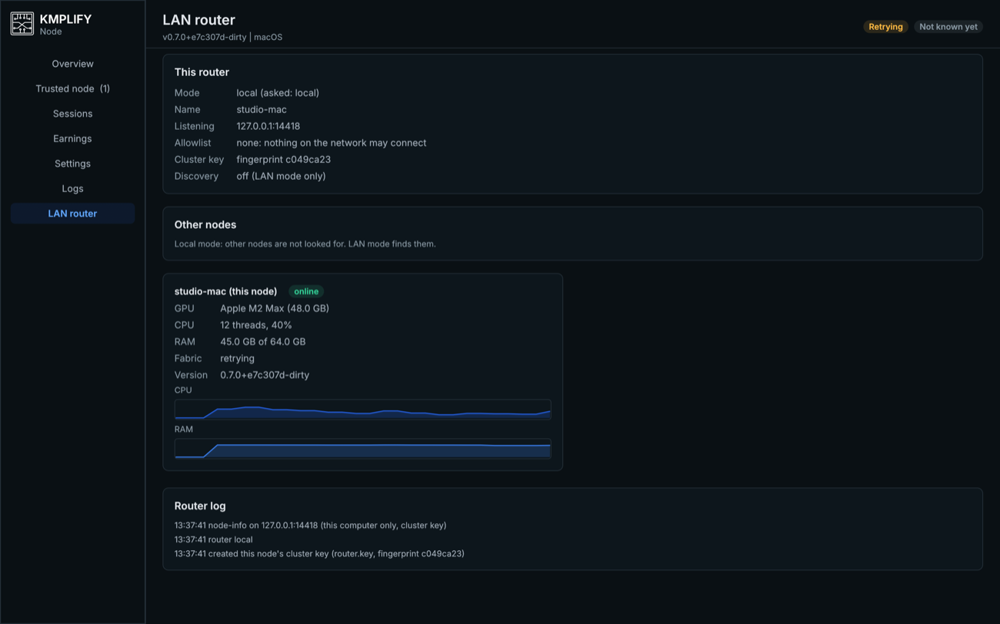

# The LAN router and the app window

kmplify-node can show the kmplify-nodes on your local network side by side:
their hardware, their live load and what they serve. This is the **LAN
router**. Its first phase is here; routing requests between the machines
follows (see "What comes next").

The **app window** is the node's native window: the same sections, figures
and buttons as the web dashboard and the terminal view. The LAN router is one
of those sections in all three views.

## The app window



```
kmplify-node --ui app        # start the node with its window (also: --ui native)
kmplify-node window          # open the window of the node already running here
```

In the web dashboard and the terminal view, **App window** (key `a`) opens
it while the node runs. The window is a process of its own that attaches to
the node the way `kmplify-node tui` does: closing it leaves the node running,
and stopping the node closes it.

Where the window cannot open (no display, or a build without the
`native-gui` feature such as the static Linux release binaries), the node
opens the dashboard in a browser app window instead (Edge, Chrome, Chromium
or Brave in app mode), and says so.

Linux needs the display libraries at runtime: libGL/libEGL, libxkbcommon and
X11 or Wayland client libraries, which every desktop installation has.

The window uses Inter, the KMPLIFY text face (SIL Open Font License 1.1, see
`src/native/fonts/OFL.txt`), follows the system's light or dark setting, and
draws nothing that is not in the node's own status file.

## The LAN router

Off until you choose:

| Mode | What listens | Who may connect |
|---|---|---|
| `off` (default) | nothing | nobody |
| `local` | `127.0.0.1:14418` | programs on this computer, with the cluster key |
| `lan` | `0.0.0.0:14418` and an mDNS announcement | addresses on the allowlist, with the cluster key |

```
kmplify-node set router=local
kmplify-node set router=lan router-allow=192.168.1.0/24
kmplify-node router            # what it is doing
kmplify-node router key        # show the cluster key (first node)
kmplify-node router join       # paste it on every other node (read from stdin)
kmplify-node router new-key    # replace it; every other node must join again
kmplify-node set router-name=studio   # how this node is called to the others
```

The same settings exist as environment variables: `KMPLIFY_ROUTER`,
`KMPLIFY_ROUTER_ALLOW`, `KMPLIFY_ROUTER_NAME`, and `KMPLIFY_ROUTER_PORT`
(default 14418). A running node follows changes within a second.

### In every view

The **LAN router** section of the web dashboard, the terminal view (key `o`)
and the app window shows the same three panels (This router, Nodes on the
network, Router log) from one model (`views::router_model`) and changes the
same things through one action layer (`views::perform`):

| What | Web dashboard | Terminal view | App window |
|---|---|---|---|
| Mode off, local, lan | mode buttons | `M` cycles | mode buttons |
| Allowlist | field, Save | `A` | field, Save |
| Name | field, Save | `N` | field, Save |
| Join a cluster | password field | `J` (typed masked) | password field |
| New cluster key | button, asks first | `K`, asks first | button, asks first |

The views show the key's **fingerprint** only. The key itself is shown by
`kmplify-node router key` on the machine, never by a view, and a key typed
into a view is stored and forgotten, never echoed or logged.

### Embedding (kmplify-desktop)

An application that embeds the router runs `router::run_with` and acts with
`views::perform_with`, both with its own `router::KeyStore`: kmplify-desktop
keeps the cluster key in its credentials store instead of `router.key`. Key
format (64 hex characters) and fingerprint (the first 4 bytes of SHA-256 over
`kmplify-router-v1/fingerprint/` and the key) are the same, so a desktop and
a node join one cluster with the same key.

### Security model

* **Off by default.** Nothing listens and nothing is announced until the
  operator turns the router on.
* **Loopback by default.** `local` binds 127.0.0.1 only; the bound address is
  checked again after binding.
* **LAN only on explicit opt-in**, and only with an allowlist. Entries must
  be private (10/8, 172.16/12, 192.168/16, fc00::/7), link-local
  (169.254/16, fe80::/10) or CGNAT/VPN (100.64/10) ranges; `0.0.0.0/0` or a
  public address is refused. LAN mode without an allowlist or without a
  cluster key stays local and says why.
* **Dropped before reading.** A connection from an address that may not
  connect is closed without a byte read and without an answer.
* **Every request is authenticated**, loopback included: an HMAC-SHA256
  signature with the cluster key over method, path, time and a random nonce.
  Requests more than 30 seconds off are refused, and a nonce is accepted
  once. The key itself never crosses the network.
* **Every answer is signed back** over the request's nonce and the body, so a
  node accepts figures only from a holder of the key.
* **The key** is 32 random bytes in `router.key` in the node directory,
  owner-only (0600; on Windows an ACL for the current user only), never in
  `settings.json`. Screens and the mDNS record show only an 8-character
  fingerprint.
* **What a node tells the others:** hardware, load, fabric link state, model
  names and job counts. Never credentials, consumers, prompts or log lines.
  A node is named `node-` plus the start of its node id unless you name it;
  the computer's name, which often carries a person's, is not used.
* **Plain HTTP, signed:** the report is readable on the wire by someone on
  the same network, but not forgeable and not obtainable without the key.
  Inference between machines (next phase) will not travel this way; it waits
  for mutual TLS.

## What comes next

1. Routing proxies (one OpenAI- and Ollama-compatible endpoint that sends
   each request to the best placed node), over pinned-certificate mutual TLS
   after PIN pairing.
2. Remote engine control for paired nodes.
3. The router as an installation admin view in the KMPLIFY web app.

The design adapts NVIDIA's Personal AI Router (Apache-2.0); see NOTICE.
